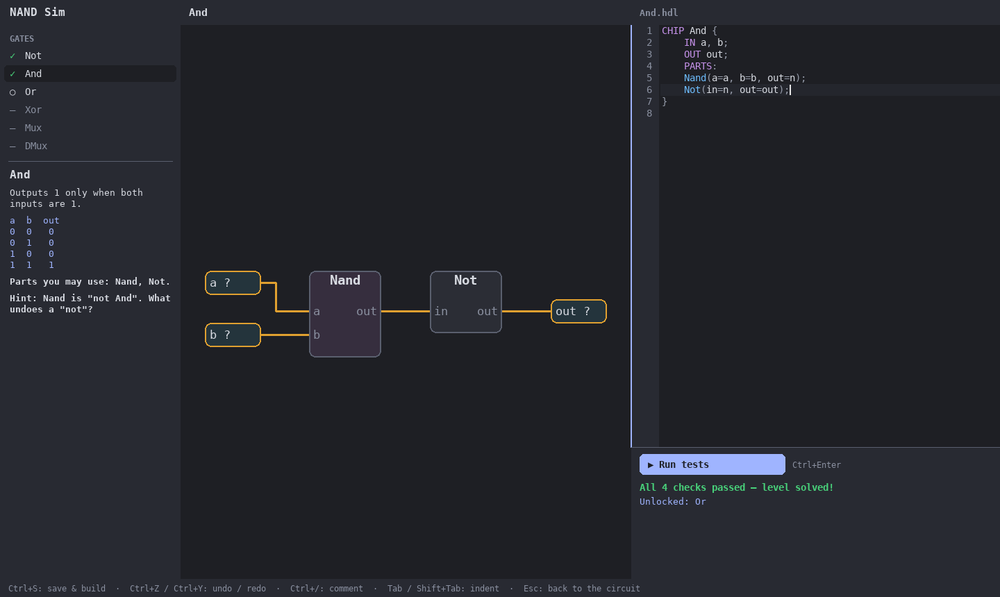

# NAND Sim

A game where you build a working RISC-V (RV32I subset) CPU starting from a single NAND gate.
You write each chip in a small HDL inside the game's editor, test it, and use it as a part in
the next level.

Work in progress — see `CLAUDE.md` for the full spec and milestones.

```bash
uv sync
uv run nandsim gui                                # play
uv run nandsim test                                # run every level
uv run nandsim gui reference/01_gates/Mux.hdl     # edit a chip and watch its circuit
```



License: MIT.
